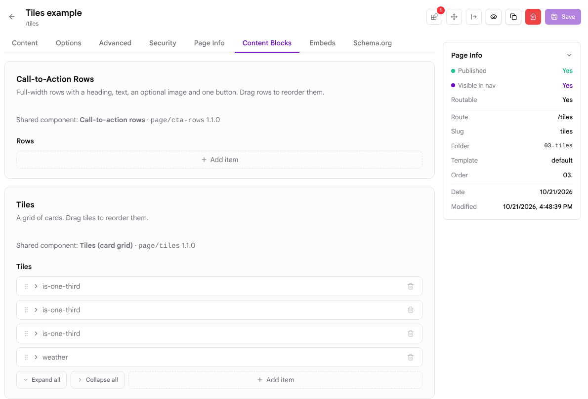
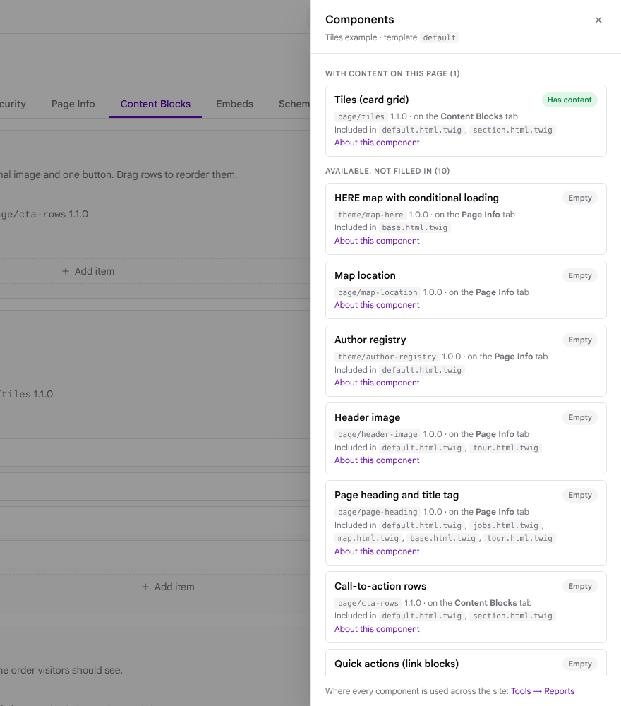
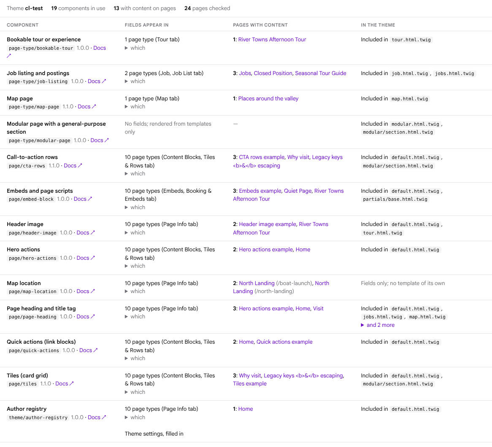

# Grav CMS Component Library

[](https://github.com/Subschema-LLC/grav-cms-component-library/actions/workflows/test.yml)
[](TESTING.md)
[](LICENSE)

Reusable, tested patterns for [Grav CMS](https://getgrav.org) themes, pages and
plugins: blueprint fragments, Twig partials, page types, and the Grav 2
practices behind them. Each pattern records the real problems it solves, and
the whole library is machine-readable, so people and AI agents can pick and
apply patterns the same way.

- **26 patterns** across four levels: [theme](docs/CATALOG.md#theme-level),
  [page](docs/CATALOG.md#page-level), [page types](docs/CATALOG.md#page-types)
  and [system](docs/CATALOG.md#system-level).
- **Tested on Grav 2.2.11 and 1.7.53**: every blueprint resolves through
  Grav's own loader and through the API that Admin2 uses, every template
  compiles and renders, and 450+ render checks run in CI on every pull request. See [TESTING.md](TESTING.md).
- **Framework-neutral markup** (`cl-*` BEM classes) with a small optional
  stylesheet, and a `classes` parameter on every partial to add Bulma,
  Bootstrap or Tailwind classes without overriding templates.
- **Drop-in for existing content**: header keys match the ones sites already
  store; where a structure changed, templates still read the older keys.

## Install

As a plugin (recommended), from your Grav root:

```bash
git clone https://github.com/Subschema-LLC/grav-cms-component-library user/plugins/component-library
bin/grav clearcache
```

The folder must be named `component-library`. The plugin adds the library to
Twig's template paths (after your theme, so your theme can override any
partial), registers the option providers some blueprints use, and loads an
optional stylesheet you can switch off in its settings.

## Use a pattern

Every pattern is a folder under `patterns/<level>/<name>/` with a
`pattern.yaml`, a generated `README.md`, and the files to use.

**1. Import its fields** into a page or theme blueprint. `import@` goes on the
field that receives them, as a sibling of `type:`. Several imports on one field
are placed in reverse order (here CTA rows appear above tiles):

```yaml
# user/themes/mytheme/blueprints/default.yaml
extends@: default
form:
  fields:
    tabs:
      fields:
        content_blocks:
          type: tab
          title: Content Blocks
          import@1:
            type: page/tiles/blueprint
            context: 'plugin://component-library/patterns'
          import@2:
            type: page/cta-rows/blueprint
            context: 'plugin://component-library/patterns'
```

**2. Include its partial** in a template, with your framework's classes if you want them:

```twig


```

**3. Check it** with the pattern's `verify` list, and lint your theme:

```bash
bin/plugin component-library lint user/themes/mytheme
```

Page types (map page, job listing, bookable tour, modular page) also ship a
page blueprint and a template scaffold to copy into your theme; their READMEs
list the steps.

### Without the plugin

Copy what you need into your theme: fragments to
`blueprints/partials/<name>.yaml` (then `context: 'theme://blueprints'`,
`type: partials/<name>`), templates under `templates/patterns/` with the same
paths, and `patterns/_shared/macros.html.twig`. Patterns that list the plugin
under **Requires** explain what to move into your theme class instead.

## See where components are used

In Grav 2's Admin the plugin shows where the library's components are used,
so editors can tell shared components from the theme's own fields and
developers can see what a change will touch:

- **Labels in forms.** A line under each component's fields names it and its
  version, and says when the theme renders it with its own template.
- **A Components panel in the page editor.** A toolbar button, with the number
  of components that have content on the page, opens a list of every
  component the page's template offers: whether this page fills it in, which
  tab it is on, how the theme renders it, and a link to its docs.
- **A usage report under Tools → Reports.** Every component in use: the page
  types and theme settings whose forms include it, the pages with content in
  it (linked to their editor), the theme templates that include it and any
  copies the theme keeps of its templates, plus the template checks on the
  active theme.

| Labels | Components panel | Usage report |
|---|---|---|
|  |  |  |

Each can be turned off in the plugin's settings (Grav 2 Admin section). The
same data is available from the command line and to AI agents:

```bash
bin/plugin component-library usage              # the whole site
bin/plugin component-library usage --page=/about
bin/plugin component-library usage --json
```

The plugin's `mcp.yaml` gives the [Grav MCP server](https://learn.getgrav.org/20/advanced/mcp-server)
`component_library_usage` and `component_library_page_components` tools.

A component counts as used on a page when one of its fields holds a value
other than its default. Fields are traced through the `cl_pattern` tag every
fragment field carries, so fields a theme defines itself are never counted,
and fragments copied into a theme before 1.3.0 need the tags added. Grav 1.7's
Admin shows none of this; the command works on both. Admin2 has no way for a
plugin to add a column to the Pages list, so the panel and the report are
where per-page usage appears.

## What's inside

| Level | Patterns |
|---|---|
| Theme | site logo, author registry, footer columns, head and body-end scripts, data layer, HERE map with conditional loading, Schema.org graph |
| Page | page heading and title tag, header image, hero actions, quick actions, tiles, CTA rows, map location, embeds and page scripts |
| Page types | map page, job listing and postings, bookable tour, modular page |
| System | compatibility flag, Admin2-safe plugin forms, dynamic select options, front-end output guards, Twig in content, template hygiene, environments and secrets |

The full list with summaries is in [docs/CATALOG.md](docs/CATALOG.md).

## For AI agents

- [`AGENTS.md`](AGENTS.md): how to choose, apply and verify patterns, and the
  Grav rules generated code most often gets wrong.
- [`catalog.json`](catalog.json): every pattern with its import type, include
  path, stored data, problems solved and verification steps.
- [`llms.txt`](llms.txt): an index of raw file links.
- Works alongside the [Grav MCP server](https://learn.getgrav.org/20/advanced/mcp-server):
  read a site's blueprints with `get_blueprint`, apply patterns, and confirm
  the fields resolved.

## Contributing

Bug reports, fixes and new patterns are welcome. [CONTRIBUTING.md](CONTRIBUTING.md)
covers setting up throwaway Grav installs (`tests/setup-grav.sh`), running the
tests, and what a new pattern needs: real problems in `solves`, a fixture page
and checks, and passing CI on Grav 1.7 and 2.x. The pattern format is in
[docs/PATTERN_SPEC.md](docs/PATTERN_SPEC.md).

Please follow the [code of conduct](CODE_OF_CONDUCT.md), and report security
problems privately as described in [SECURITY.md](SECURITY.md).

## License

MIT. See [LICENSE](LICENSE).
